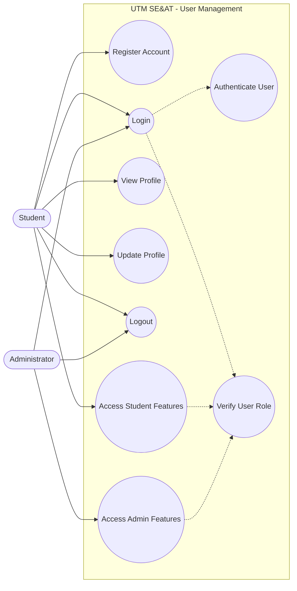
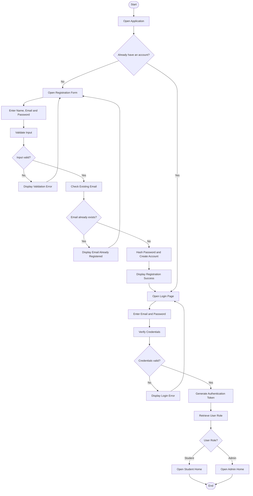
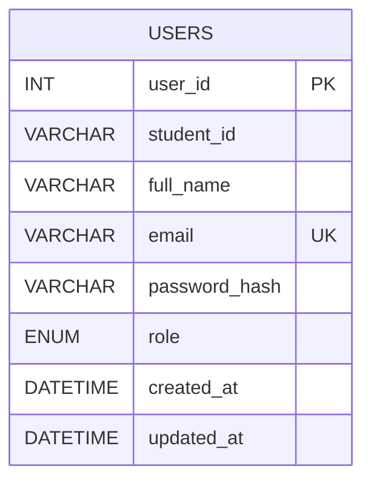

# User Management Subsystem – Sprint 1

## 1. Use Case Diagram

## 2. Activity Diagram – Registration and Login

## 3. Initial ERD – User Management

## 4. UI/UX Wireframe Components

### Register Page
- UTM SE&AT title
- Student ID field
- Full name field
- Email address field
- Password field
- Create Account button
- Login link

### Login Page
- Email address field
- Password field
- Login button
- Register link
- Error message area

### Student Home
- Welcome message
- Cafeteria shortcut
- Seat availability shortcut
- My Profile
- Logout

### Admin Home
- Admin dashboard
- Manage Users
- Manage Cafeterias
- Manage Seats
- My Profile
- Logout

### Profile Page
- Student ID
- Full name
- Email
- Role
- Update Profile button
